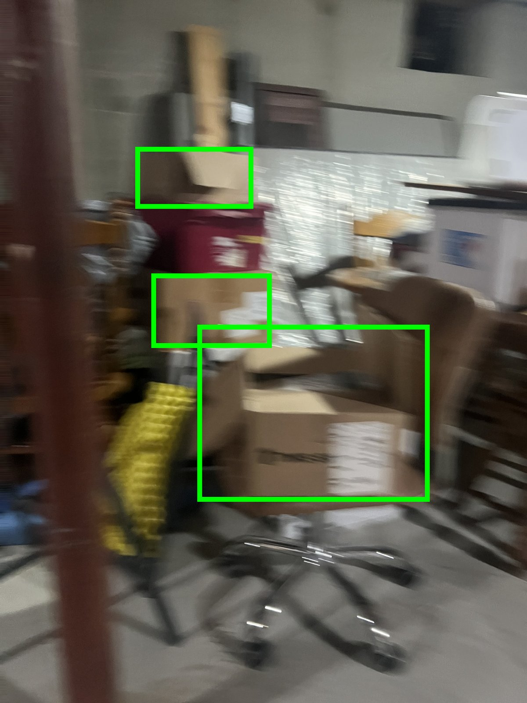
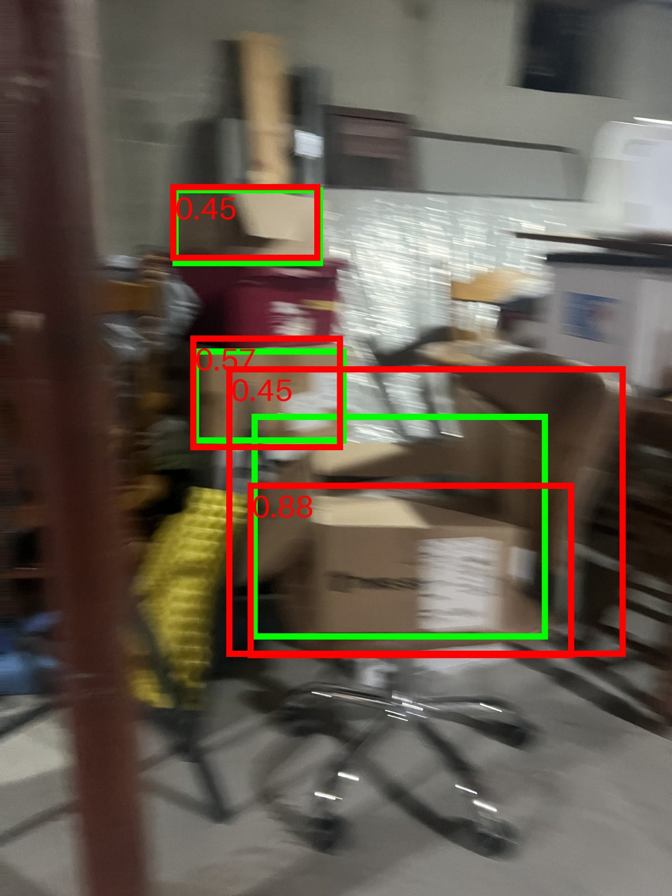
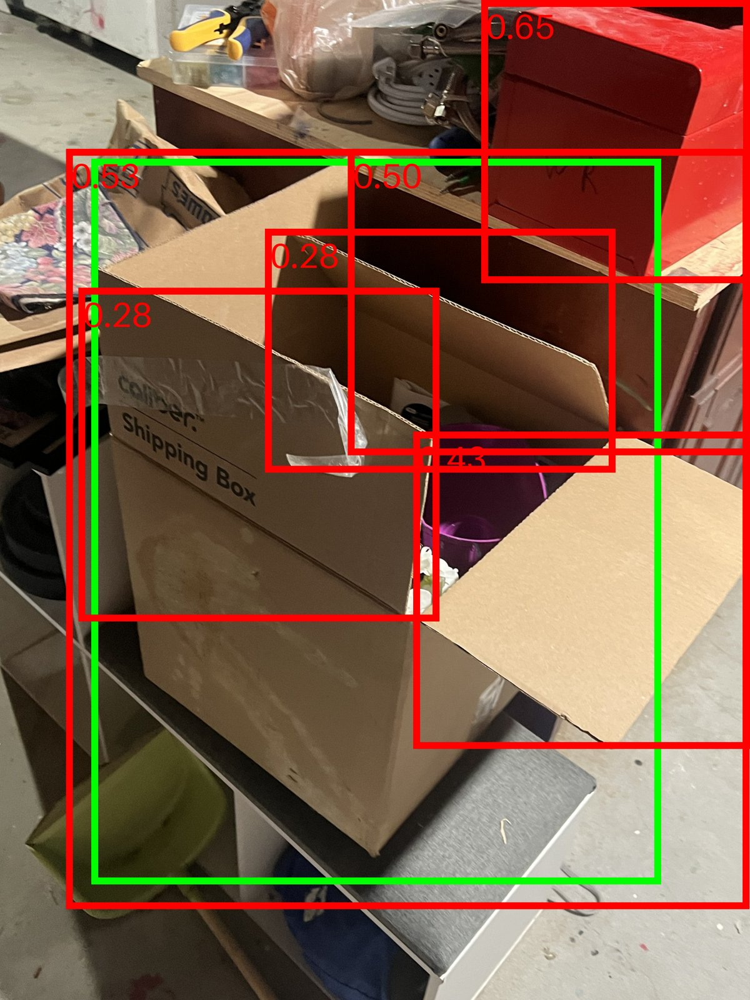
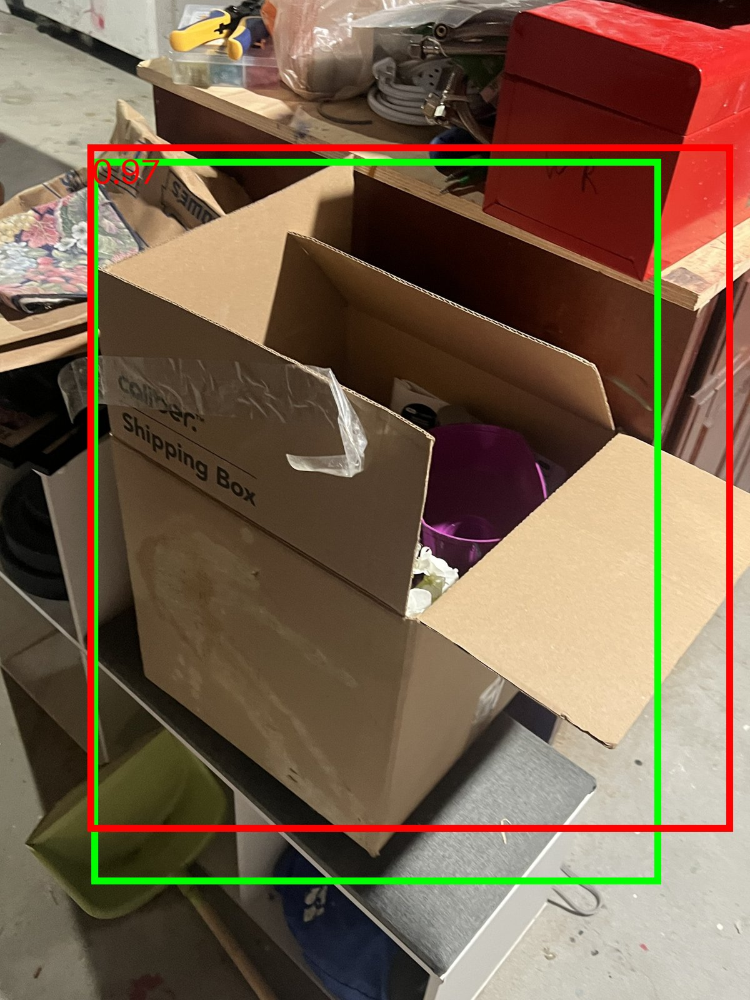

# Box Detection Robustness Test

How well does an off-the-shelf detector find cardboard boxes in a cluttered, badly lit basement, where exactly does it fail, and does one targeted fix move the number?

**Result.** Zero-shot YOLO-World ("cardboard box" prompt) scores **F1 0.50** on 57 held-out photos: it finds two thirds of the boxes, but three of every five detections are phantoms. Inspecting all 68 phantoms and 23 misses showed the biggest sources are duplicate detections on one box (31%), background clutter (25%) and box-shaped non-cardboard containers (24%), with motion blur the worst condition (recall 0.14). Fine-tuning YOLOv8n on 57 disjoint training photos plus a motion-blurred copy of each raises test **F1 to 0.71** and blur recall to 1.00. White boxes did not improve (recall 0.44 before and after; only five in the training split), and phantoms on empty scenes rose from 1 to 4.

This is a small, one-location, one-photographer study. The numbers are directional. The method is the point.

| blurred boxes, baseline | blurred boxes, fine-tuned | one box drawn six times, baseline | fine-tuned |
|:-:|:-:|:-:|:-:|
|  |  |  |  |

<sub>Green = ground truth, red = prediction with confidence.</sub>

## Before / after, same 57 test images, same threshold 0.25, same scorer

| condition | images | boxes | precision | recall | F1 |
|---|---|---|---|---|---|
| **overall** | 57 | 68 | 0.40 → **0.65** | 0.66 → **0.78** | 0.50 → **0.71** |
| sharp | 47 | 61 | 0.39 → 0.64 | 0.72 → 0.75 | 0.51 → 0.69 |
| blur | 10 | 7 | 1.00 → 0.70 | 0.14 → **1.00** | 0.25 → 0.82 |
| unoccluded | 22 | 11 | 0.45 → 0.63 | 0.82 → 0.91 | 0.58 → 0.74 |
| occluded | 35 | 57 | 0.39 → 0.65 | 0.63 → 0.75 | 0.48 → 0.70 |
| brown | 26 | 39 | 0.41 → 0.78 | 0.67 → 0.82 | 0.51 → 0.80 |
| white | 8 | 9 | 0.31 → 0.29 | 0.44 → **0.44** | 0.36 → 0.35 |
| no box (phantom count) | 13 | 0 | 1 → **4** | | |

Full tables: [`results/baseline_metrics.csv`](results/baseline_metrics.csv), [`results/finetuned_metrics.csv`](results/finetuned_metrics.csv). Chart: [`results/before_after.png`](results/before_after.png).

## What was done

- **Data.** 114 iPhone photos, stored at half resolution (2016 px long edge), otherwise unedited. 26 contain no box and serve as negatives. Each photo is tagged on four axes (box count, blur, occlusion, color) in [`data/conditions.csv`](data/conditions.csv); the tags were assigned by eye with a small local page ([`src/tag_conditions.py`](src/tag_conditions.py)) and the photos imported with [`src/import_photos.py`](src/import_photos.py).
- **Labels.** One class, `box`: cardboard only, labelled if more than ~30% visible, drawn tight. 136 boxes. First pass drawn with assistance in Roboflow, then every image reviewed and corrected by hand. YOLO format in [`data/labels/`](data/labels/).
- **Split.** 57 train / 57 test, seeded, stratified on box count and blur, assigned before any model ran. The test split was never used for training, checkpoint selection or threshold choice.
- **Baseline.** YOLO-World `yolov8s-worldv2`, prompt "cardboard box", confidence 0.25 fixed in [`src/config.py`](src/config.py) before any result was seen.
- **Scoring.** [`src/evaluate.py`](src/evaluate.py), written by hand: IoU, greedy confidence-ordered matching at IoU 0.5, precision / recall / F1 per condition. Hand-verified on three images. Unit tests in [`tests/`](tests/) and a matching C++ IoU + NMS implementation with GoogleTest in [`cpp/`](cpp/).
- **Failure analysis.** Every false positive and miss cropped and categorised. Ten annotated images with a hypothesis each in [`results/failures/`](results/failures/README.md).
- **Improvement.** [`src/finetune.py`](src/finetune.py): YOLOv8n, 30 epochs, 640 px, seed 0, brightness jitter, plus an offline motion-blurred copy of every training image. Scored with the same script and threshold.

## Follow-up experiments

Three questions a reviewer would ask, answered on the same 57 test images.

| experiment | precision | recall | F1 | phantoms on 13 empty images |
|---|---|---|---|---|
| zero-shot baseline, conf 0.25 | 0.40 | 0.66 | 0.50 | 1 |
| + C++ NMS at IoU 0.5 | 0.43 | 0.65 | 0.52 | 1 |
| + C++ NMS at IoU 0.3 | 0.46 | 0.63 | 0.53 | 1 |
| + conf 0.40 (chosen on the train split) | 0.64 | 0.56 | 0.60 | 0 |
| + NMS 0.3 and conf 0.40 | 0.65 | 0.54 | 0.59 | 0 |
| fine-tuned, **no** blur copies | 0.31 | 0.57 | 0.40 | 46 |
| fine-tuned, with blur copies | 0.65 | 0.78 | 0.71 | 4 |

- **Is the gain the blur augmentation or just fine-tuning?** The augmentation. Fine-tuning on the 57 originals alone is worse than zero-shot (F1 0.40) and hallucinates boxes in 46 places on empty scenes; adding the blurred copies brings it to 0.71. Caveat: the copies also double the training set, so some of the effect is data volume, not blur specifically.
- **Would NMS fix the duplicate detections instead?** Only partly. NMS with the C++ implementation in [`cpp/`](cpp/) (run through [`src/apply_nms.py`](src/apply_nms.py)) removes 11 to 20 of 113 boxes and lifts F1 by 0.02 to 0.03. Most fragment detections sit on different flaps of the same box and overlap each other by less than 0.3, so suppression cannot see them as duplicates.
- **Was the threshold left on the table?** Some. A sweep on the train split ([`src/threshold_sweep.py`](src/threshold_sweep.py), [`results/threshold_sweep_train.csv`](results/threshold_sweep_train.csv)) picks 0.40 by train F1; applied to test it trades recall for precision and reaches F1 0.60. Still well short of the fine-tune, and it does nothing for blur (recall stays 0.14).

Reproduce: `python apply_nms.py --predictions ../results/predictions/baseline.csv --iou 0.3 --output ../results/predictions/baseline_nms30.csv`, `python finetune.py --no-blur --name finetune_noblur`, `python run_baseline.py --split train --conf 0.05 --output ...` then `python threshold_sweep.py --predictions ...`.

## Limitations

- 57 test images. The blur cell has 7 boxes and the white cell 9, so one box moves those recalls by 0.11 to 0.14.
- One training run. An earlier run with identical settings on the full-resolution originals landed at F1 0.73 with blur recall 0.57 and white recall 0.33, so per-condition deltas vary run to run; the overall gain does not.
- One basement, one evening, one phone. Lighting was not varied. Not warehouse data.
- Single annotator. Validation set = training set (no third split at this size), so checkpoint choice is not an overfitting guard; the test score is.

## Reproduce

```bash
python3 -m venv .venv && source .venv/bin/activate && pip install -r requirements.txt
cd src
python run_baseline.py
python evaluate.py --predictions ../results/predictions/baseline.csv --output ../results/baseline_metrics.csv
python finetune.py                                   # ~12 min on an M1 Pro
python run_baseline.py --weights ../results/runs/finetune/weights/best.pt --output ../results/predictions/finetuned.csv
python evaluate.py --predictions ../results/predictions/finetuned.csv --output ../results/finetuned_metrics.csv
python make_report.py                                # tables + before_after.png
cd .. && python -m pytest tests                      # Python scorer tests
cmake -S cpp -B cpp/build && cmake --build cpp/build && ctest --test-dir cpp/build   # C++ IoU/NMS tests
```

Model weights download on first use (~400 MB).
